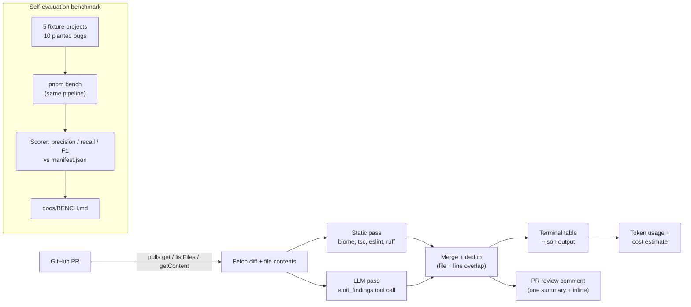

# PR-Warden

> An AI code reviewer that reviews pull requests like a strict senior engineer - and publishes its own precision/recall benchmark so you know how much to trust it.

## The problem

AI code reviewers promise thoroughness, but nobody can tell you how often they are *wrong*. When a human senior engineer reviews code, you can roughly calibrate how much to trust their verdicts; when an LLM does it, the failure modes are silent: hallucinated findings waste your time, and missed real bugs give you false confidence.

PR-Warden attacks this from two sides. First, it combines deterministic static analysis (biome, tsc, eslint, ruff) with an LLM reasoning pass that must emit structured, severity-classified findings through a schema - so its output is measurable, not vibes. Second - and this is the part no public code reviewer ships - it benchmarks *itself*: a harness of fixture projects with planted bugs (SQL injection, off-by-one, unhandled promises, race conditions, type confusion) is run through the exact same review pipeline, and the results are scored into precision, recall, and F1. Where real numbers belong, the repo refuses to publish unverified ones: `pnpm bench` measures them with your own API key in one command.

## Quickstart

Prerequisites: Node 20+ and pnpm 9 (`corepack enable`, or `npm install -g pnpm@9`), plus an API key for any OpenAI-compatible endpoint. The default preset is Google Gemini - free keys from [Google AI Studio](https://aistudio.google.com) - and OpenRouter works out of the box too.

Your first review in 60 seconds (from source):

```bash
git clone https://github.com/ABetancourtRendon/pr-warden
cd pr-warden
pnpm install
export LLM_API_KEY=your-gemini-key        # PowerShell: $env:LLM_API_KEY = "your-gemini-key"
pnpm dev review --repo owner/name --pr 123
```

PowerShell, start to finish:

```powershell
git clone https://github.com/ABetancourtRendon/pr-warden
cd pr-warden
corepack enable                            # or: npm install -g pnpm@9
pnpm install
$env:LLM_API_KEY = "your-gemini-key"
pnpm dev review --repo owner/name --pr 123
```

Once the package is published to npm (see SETUP.md for the one-time publish step), the CLI and the GitHub Action become installable directly:

```bash
npx pr-warden review --repo owner/name --pr 123
```

And any repository installs the reviewer with five lines of workflow YAML:

```yaml
- uses: ABetancourtRendon/pr-warden@main
  with:
    github_token: ${{ github.token }}
    pr_number: ${{ github.event.pull_request.number }}
    llm_api_key: ${{ secrets.LLM_API_KEY }}
```

(The surrounding workflow needs the usual `on: pull_request` trigger and `permissions: pull-requests: write`; see [action.yml](action.yml).)

## How it works



The pipeline:

1. **Fetch.** The CLI pulls the PR metadata, changed-file list, diff hunks, and (for text files) the full new-file content. Public repos need no auth; `GITHUB_TOKEN` raises rate limits and is required to post reviews.
2. **Static pass.** Changed files are copied into an isolated temp workspace and linted with every tool available there: biome (bundled as a runtime dependency), tsc and eslint (when resolvable in the environment), ruff (when the binary is on PATH). Linter output is normalized into the common Finding format with severity/category mapping.
3. **LLM pass.** One request through a thin OpenAI-compatible adapter (system prompt: strict senior reviewer; user prompt: numbered file contents and hunks). The model must call the `emit_findings` tool; the payload is validated against a zod schema. One retry on schema violation, then graceful degradation to static-only findings.
4. **Merge and dedup.** Static and LLM findings on the same file with overlapping line ranges collapse into one finding - the higher severity wins, ties go to the LLM finding, and cross-source merges are marked corroborated with a confidence bump.
5. **Report.** A terminal table or `--json`, with token usage and estimated cost per run. With `--post`, a single GitHub review API call publishes one grouped summary comment (severity table plus details) and inline comments on findings whose lines are part of the diff.

## Configuration

Repository-level configuration lives in `.warden.yml` (see [this repo's own file](.warden.yml) for a live example):

| Key | Default | Meaning |
|---|---|---|
| `categories` | all five | Which finding categories to report (bug, security, performance, maintainability, style) |
| `min_severity` | `info` | Findings below this severity are dropped |
| `ignore_paths` | node_modules/dist/coverage | Gitignore-style globs for paths to skip |
| `custom_rules` | - | Natural-language rules appended to the reviewer system prompt |
| `max_inline_comments` | `20` | Cap on inline PR comments (the rest live in the summary) |
| `provider.preset` / `provider.base_url` / `provider.model` | gemini | Provider selection; environment variables win over the file |

Environment variables (`env`, or a gitignored `.env` file - see [.env.example](.env.example)):

| Variable | Meaning |
|---|---|
| `LLM_BASE_URL` | OpenAI-compatible endpoint (preset table below) |
| `LLM_API_KEY` | Provider API key; without it the review runs static-only |
| `LLM_MODEL` | Model name at the endpoint |
| `GITHUB_TOKEN` | Optional GitHub token for rate limits and posting reviews |

Provider presets:

| Preset | `LLM_BASE_URL` | Example model |
|---|---|---|
| gemini (default) | `https://generativelanguage.googleapis.com/v1beta/openai/` | `gemini-2.5-flash` |
| openrouter | `https://openrouter.ai/api/v1` | `google/gemini-2.5-flash` |
| openai | `https://api.openai.com/v1` | `gpt-4o-mini` |
| anthropic | `https://api.anthropic.com/v1/` | `claude-sonnet-4` |
| groq | `https://api.groq.com/openai/v1` | `llama-3.3-70b-versatile` |

CLI flags: `pr-warden review --repo <owner/name> --pr <number> [--json] [--post] [--provider mock] [--no-static] [--no-llm] [--fail-on critical|major|minor|info] [--config <path>] [--verbose] [--no-color]`.

## The self-evaluation benchmark

Methodology (full details in [docs/BENCH.md](docs/BENCH.md)):

- Five fixture projects contain ten planted bugs total; each fixture's `manifest.json` lists file, line range, and category for every planted bug.
- The full review pipeline (static + LLM, the same code path as a real PR review) runs against each fixture.
- A finding matches a bug when file, category, and line range (with a 2-line tolerance) line up. Precision counts matched findings over eligible findings; recall counts matched bugs over planted bugs; F1 is the harmonic mean. Static findings count the same as LLM findings.
- CI runs the scoring harness against recorded MockProvider outputs and asserts the metrics byte-for-byte, proving the scorer is deterministic.

Real results table (filled in by one command with your own key - PR-Warden deliberately does not ship numbers it has not measured):

| Metric | Value |
|---|---|
| Precision | - (run `pnpm bench`) |
| Recall | - (run `pnpm bench`) |
| F1 | - (run `pnpm bench`) |
| Provider / model | - |
| Fixtures / planted bugs | 5 / 10 |

The command that fills the table:

```bash
pnpm bench                                  # bash; needs LLM_API_KEY
```

```powershell
# PowerShell
$env:LLM_API_KEY = "your-gemini-key"
pnpm bench
```

The run rewrites [docs/BENCH.md](docs/BENCH.md) with measured precision/recall/F1 overall, per category, and per fixture, plus a list of every missed bug and false positive. Commit it so the repo ships its own quality numbers.

## Design decisions and trade-offs

- **One thin provider adapter, not five SDKs.** Everything speaks the OpenAI-compatible chat-completions shape, so Gemini, OpenRouter, OpenAI, Anthropic's compatibility endpoint, and Groq work through the same tested client and the same mock. The cost: endpoints that do not support forced tool calls (`tool_choice`) will degrade to static-only instead of being special-cased.
- **Determinism before marketing.** Tests and CI never make live LLM calls; the benchmark scorer is asserted against recorded mock outputs in CI. The trade-off: the shipped BENCH.md real-results table starts empty until you measure it with your key - that is deliberate.
- **Static analysis in an isolated workspace.** Changed files are linted in a temp directory with PR-Warden's own linter config, so reviews are reproducible and never depend on the target repo's tooling. The trade-off: project-specific lint rules (e.g. an eslint plugin the target repo uses) are not applied.
- **Opportunistic tool coverage.** biome is bundled; tsc and eslint passes activate only when those packages happen to be resolvable in the runtime environment; ruff activates only when the binary is on PATH. Missing tools are skipped with a note, never faked.
- **An in-house diff walker.** parse-diff 0.12 (the obvious dependency) drops content after a second hunk header in multi-hunk patches, so PR-Warden ships its own 100-line unified-diff walker with tests.
- **Dedup by file + line overlap.** Two findings on the same code region collapse into one (higher severity wins; cross-source merges are marked corroborated). The trade-off: two genuinely distinct issues on the same line would be merged away - a rare case we accept for output cleanliness.
- **One LLM call per review.** Batching the whole PR into a single prompt (with a hard size cap) keeps cost and latency low; very large PRs get truncated file listings rather than many calls.
- **Retry once, then degrade.** Schema-violating LLM output gets exactly one corrective retry; a second failure downgrades the run to static-only findings with a clear warning instead of failing the review.

## Limitations

- No dynamic verification: findings come from static analysis and LLM reasoning; nothing is executed.
- LLM line numbers can drift by a line or two (the benchmark's 2-line matching tolerance exists precisely because of this).
- One LLM call per review means very large PRs see truncated prompts.
- No automatic backoff/retry on provider transport errors (429/5xx) - a failed provider degrades the run to static-only.
- The benchmark is small (10 planted bugs, 5 fixtures): it is directional evidence, not a scientific evaluation; the methodology is documented so you can rerun and extend it.
- Token pricing in the cost estimates is a hardcoded table of approximate list prices; unknown models report no cost estimate.
- Python findings require ruff on PATH; TypeScript type-checking of reviewed files only runs where typescript is resolvable.
- Reviews target one PR at a time; there is no org-wide batch mode yet.

## Roadmap

- More fixtures and bug classes (planted performance bugs, secret handling, auth flows) to grow the benchmark.
- Incremental reviews: only analyze commits not yet reviewed on long-lived PRs.
- Provider backoff for rate limits, and a streaming mode for large diffs.
- GitLab/Gitea support behind the same GitHubApi-shaped interface.
- Prompt self-improvement: bench results per category feed prompt adjustments, re-measured on the same fixtures.
- GitHub Action marketplace listing once the package is published.
